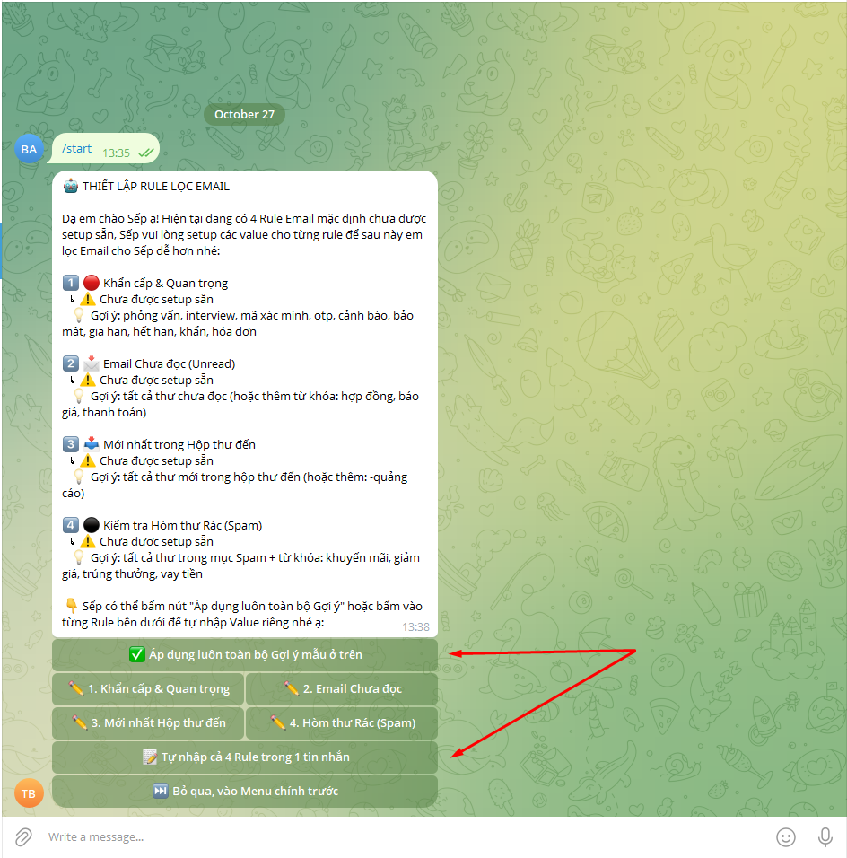
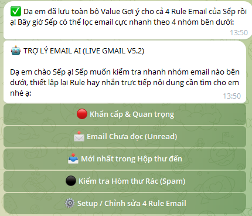
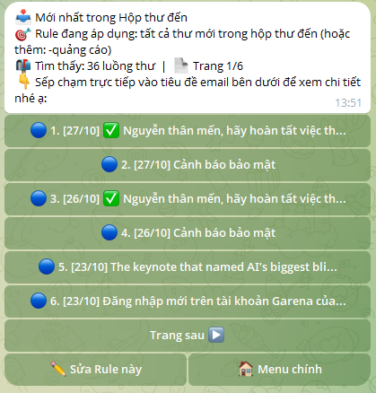
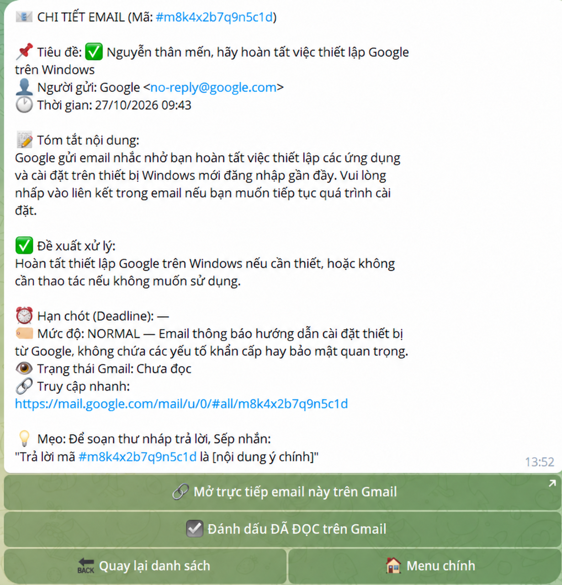

# AI Mail Agent Enterprise — Community Edition

**A Gmail assistant powered by Google Gemini and Telegram, running on Google Apps Script without a self-hosted server.**

[Tiếng Việt](README.md) · [Setup guide](docs/04-APPS-SCRIPT-SETUP.md) · [First-run walkthrough](docs/07-FIRST-RUN.md) · [Security](SECURITY.md)

  

**Author:** Trieu Nguyen IT ([@trieunguyenbg96](https://github.com/trieunguyenbg96)) · **Development:** AI-assisted development · **Agent source version:** V5.2 PRO.

## What it does

- Direct Gmail search, email lists, detail view, marking email as read, and draft assistance.
- Four editable rules: critical/important, unread, recent inbox messages, and spam.
- Natural-language Telegram interaction assisted by Gemini for email summaries and suggested actions.
- Telegram inline menus, paging, and a guided first-run rule setup.
- Standalone Google Apps Script project; no Google Sheets, Docker, or dedicated server required.

Features reflect the supplied source and demo screenshots; end-to-end production security and automated tests have **not** been certified.

## Screenshots

| Rule onboarding | Main menu |
| --- | --- |
|  |  |

| Inbox results | Demo email details |
| --- | --- |
|  |  |

More images and Vietnamese walkthrough: [First Run](docs/07-FIRST-RUN.md). Demo IDs/links in screenshots are placeholders, not real email links.

## How it works

```text
Telegram user -> Telegram Bot API -> HTTP POST -> Apps Script doPost(e)
                                                  |-> GmailApp
                                                  |-> Gemini API
                              Telegram Bot API <-|

Each installer stores their own configuration in Apps Script Script Properties.
```

## Quick start

1. Download the source or clone `https://github.com/trieunguyenbg96/AI-Mail-Agent-Enterprise.git` **after the repo has been created under this name**.
2. Create a new [Google Apps Script](https://script.google.com/home) project; paste `src/AI_Mail_Agent_Enterprise.gs` and configure the `src/appsscript.json` manifest. See [Apps Script Setup](docs/04-APPS-SCRIPT-SETUP.md).
3. Obtain your own [Gemini API key](docs/01-GEMINI-API-KEY.md), [Telegram bot token](docs/02-TELEGRAM-BOT.md), and [Telegram Chat ID](docs/03-TELEGRAM-CHAT-ID.md).
4. Open **Project Settings → Script Properties** and enter:

   | Key | Value |
   | --- | --- |
   | `GEMINI_API_KEY` | Your own Gemini API key |
   | `TELEGRAM_BOT_TOKEN` | Your BotFather token |
   | `TELEGRAM_CHAT_ID` | Your Telegram chat ID |
   | `TELEGRAM_WEBHOOK_URL` | Your `/exec` URL, after deployment |

5. Deploy as a Google Apps Script **Web app** and save its `/exec` URL under `TELEGRAM_WEBHOOK_URL`. Review Google authorization prompts. See [Deployment](docs/05-DEPLOYMENT.md).
6. Select and run **`setupBot()`** in the Apps Script editor (not `doPost(e)`). Verify the `Webhook was set` response; then send `/start` or `/menu` to your bot using a **test Gmail account**. See [First Run](docs/07-FIRST-RUN.md).

## Documentation

- [01 — Gemini API key](docs/01-GEMINI-API-KEY.md)
- [02 — Telegram Bot](docs/02-TELEGRAM-BOT.md)
- [03 — Telegram Chat ID](docs/03-TELEGRAM-CHAT-ID.md)
- [04 — Apps Script Setup](docs/04-APPS-SCRIPT-SETUP.md)
- [05 — Deployment](docs/05-DEPLOYMENT.md)
- [07 — First Run](docs/07-FIRST-RUN.md)
- [06 — Historical Code Audit](docs/06-CODE-AUDIT.md)

## Important security limitations

**This is a community demo, not a hardened production system.** The published Apps Script manifest uses `USER_DEPLOYING` and `ANYONE_ANONYMOUS`. The webhook endpoint is publicly reachable and runs code with the deploying account's authorized permissions. Chat ID filtering is **not a trusted Telegram-origin verification mechanism**: requests can be forged when the URL and allowed ID are known. This project intentionally does not include a gateway validating Telegram's secret-token header.

Use a **dedicated test Google account first**, never commit credentials or expose the full deployment URL, do not share one Gmail-owner deployment with untrusted users, and review [SECURITY.md](SECURITY.md), OAuth scopes, and API quotas before any real use. Contributors are welcome to add stronger authentication in forks or PRs.

## Repository layout

```text
src/                 Agent Apps Script source and manifest
docs/                Setup, deployment and first-run guides
images/              Tutorial screenshots
README.md            Vietnamese main readme
README.en.md         English readme
LICENSE              MIT License
SECURITY.md          Risks and security guidance
CONTRIBUTING.md      Contributions
CHANGELOG.md         Release notes
```

## License and credits

MIT License — [LICENSE](LICENSE). © 2026 **Trieu Nguyen IT**, [@trieunguyenbg96](https://github.com/trieunguyenbg96). **AI-assisted development**.
