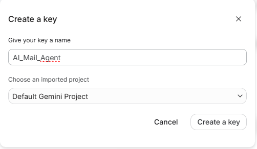
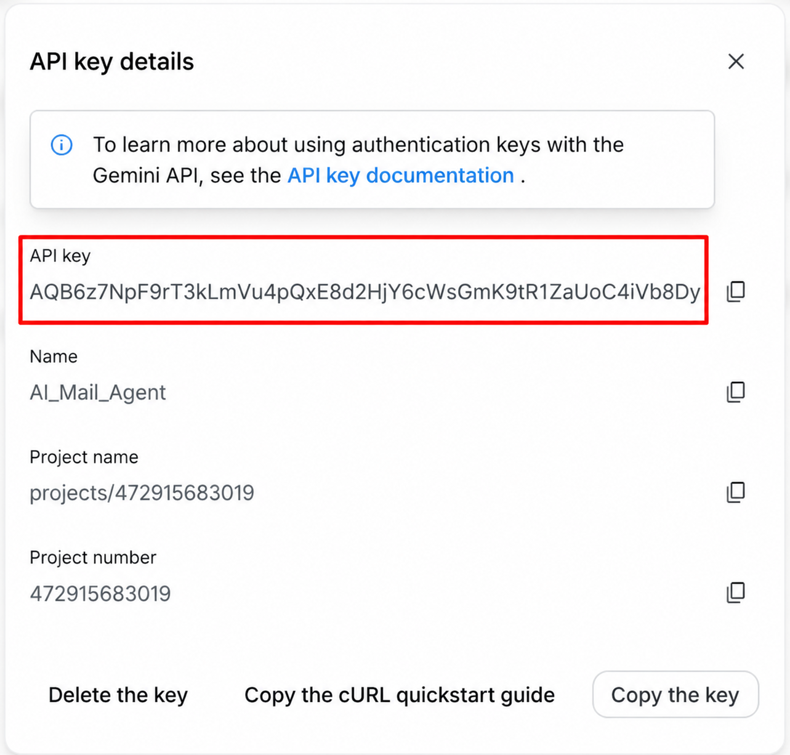

# 01 — Tạo Gemini API Key

1. Truy cập [Google AI Studio – API keys](https://aistudio.google.com/apikey) và đăng nhập tài khoản Google dùng cho Agent.
2. Chọn tạo API key mới; nhập tên dễ nhớ như `AI_Mail_Agent`, chọn Google Cloud project phù hợp và nhấn **Create a key**.

3. Mở thông tin key vừa tạo, sao chép **API key** và lưu ở nơi an toàn. Ảnh dưới chỉ mô tả vị trí lấy key; **không sao chép chuỗi xuất hiện trong hình**.

4. Sang Apps Script → **Cài đặt dự án → Thuộc tính của tập lệnh**, nhập thuộc tính `GEMINI_API_KEY` với giá trị riêng của bạn. Xem [bước 04](04-APPS-SCRIPT-SETUP.md).
5. Kiểm tra model Gemini trong mã nguồn và quyền/quota API tương ứng trước khi thử.

> **Bảo mật:** Không đặt key trong `.gs`, ảnh chụp mới, `README.md` hay issue GitHub. Nếu có khả năng key đã lộ, thu hồi và tạo key khác.
