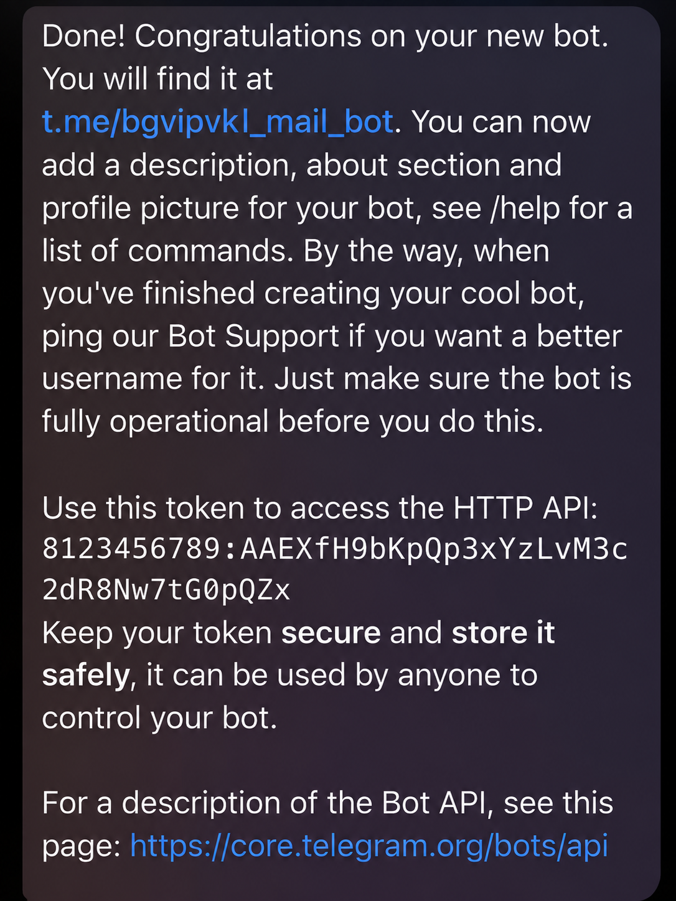

# 02 — Tạo Telegram Bot và lấy Bot Token

1. Mở [@BotFather](https://t.me/BotFather) (bot chính thức do Telegram cung cấp).
2. Nhập `/newbot`, chọn tên hiển thị và username hợp lệ (thường kết thúc bằng `bot`).
3. BotFather sẽ trả về đường dẫn bot và một **HTTP API token**.

4. Lưu token vào **Script Properties** với tên `TELEGRAM_BOT_TOKEN` như ở [bước 04](04-APPS-SCRIPT-SETUP.md).
5. Mở bot vừa tạo và gửi `/start` để bắt đầu tương tác.

> **Bảo mật:** Ảnh dùng cho tài liệu chứa token minh họa do tác giả cung cấp. Không dùng lại token trong ảnh, kể cả khi có cú pháp hợp lệ. Luôn tạo bot/token của riêng mình. Nếu token thực bị công khai, hãy thu hồi và tạo lại tại BotFather.
