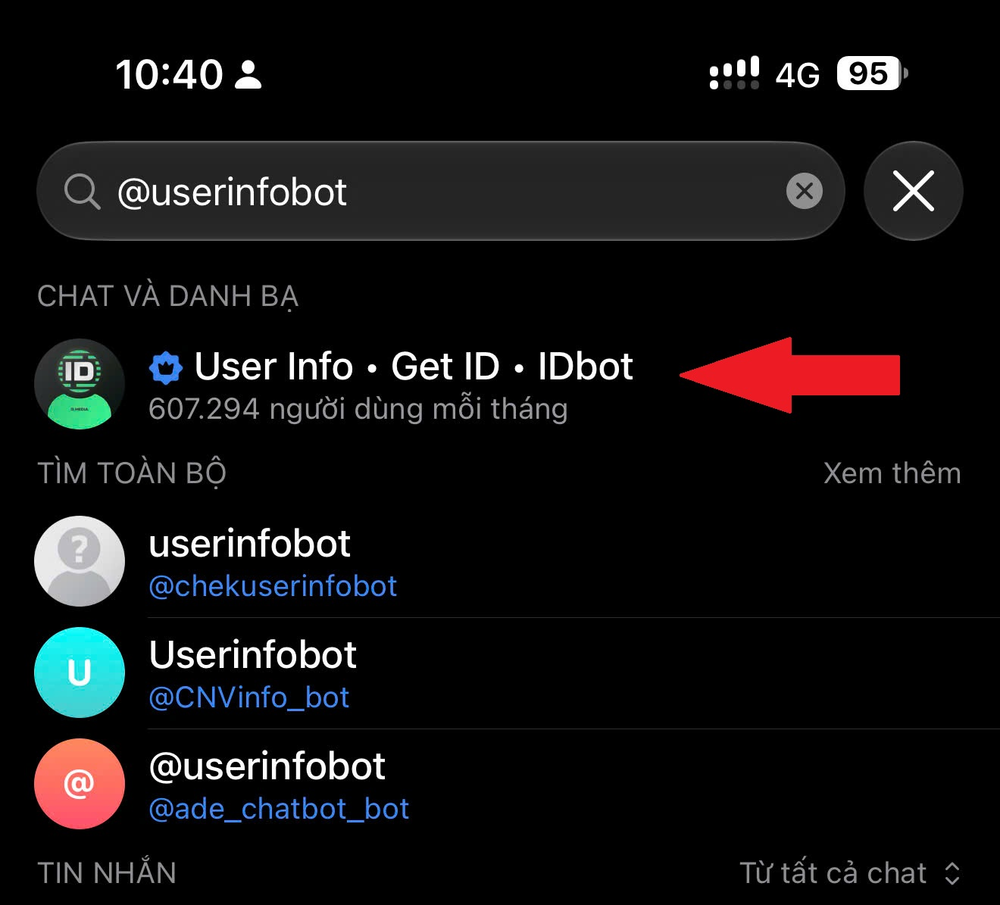
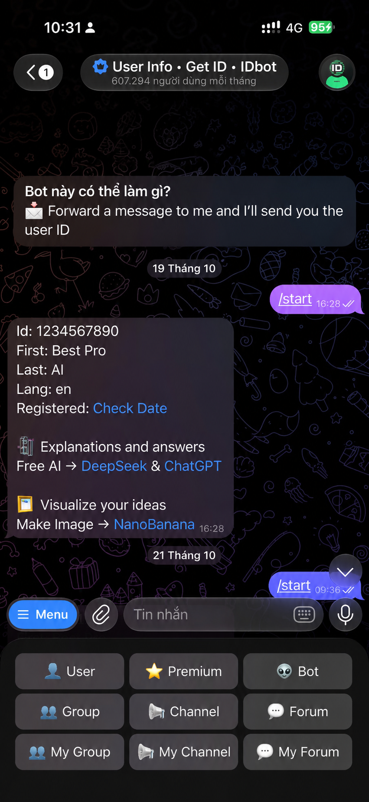

# 03 — Xác định Telegram Chat ID

1. Mở ứng dụng Telegram, tìm bot hỗ trợ tra cứu ID. Ảnh minh họa sử dụng kết quả tìm kiếm `@userinfobot`; **kiểm tra kỹ username và độ tin cậy của bên cung cấp** trước khi gửi thông tin.

2. Mở cuộc trò chuyện với bot, gửi `/start` và đọc trường **Id:** trong tin nhắn phản hồi.

3. Điền số nhận được vào `TELEGRAM_CHAT_ID` trong **Script Properties**.

**Cách khác không phụ thuộc bot bên thứ ba:** Gửi tin nhắn cho bot riêng trước khi thiết lập webhook; truy vấn `getUpdates` qua Telegram Bot API trong môi trường riêng, lấy `message.chat.id`. Không dán URL có token vào nơi công khai. Khi webhook đã bật, không dùng `getUpdates` đồng thời.

> Chat ID không phải mật khẩu nhưng là thông tin định danh: dùng số minh họa khi viết tài liệu công khai.
