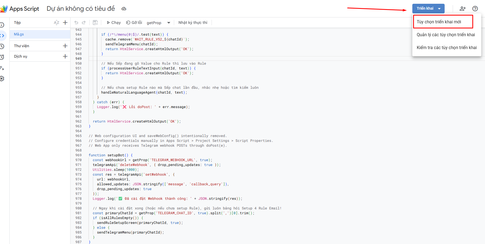
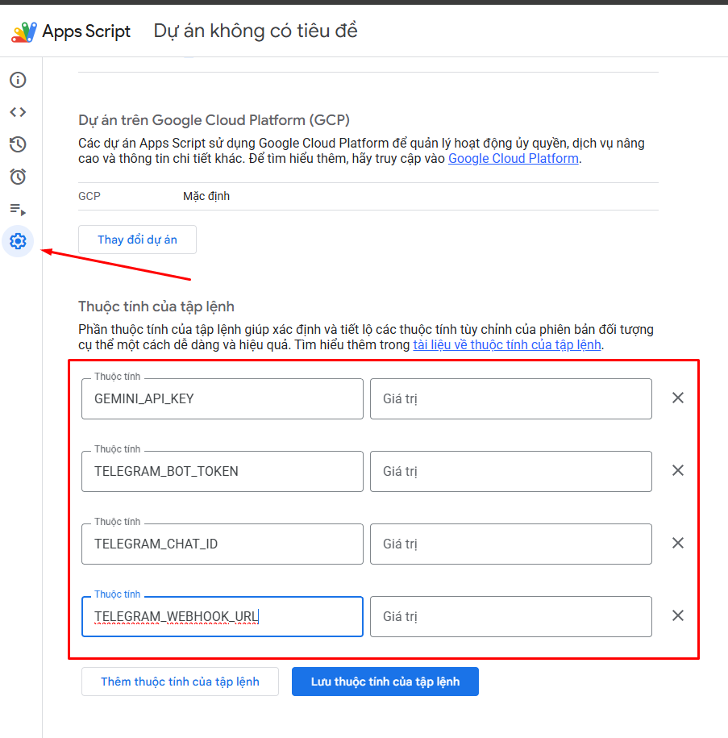

# 04 — Tạo dự án Apps Script và thiết lập Script Properties

1. Truy cập [Google Apps Script](https://script.google.com/home), tạo dự án độc lập và đặt tên, ví dụ `AI_Mail_Agent_Enterprise`.
2. Trong trình chỉnh sửa, thay nội dung file `.gs` bằng toàn bộ mã nguồn tại [`src/AI_Mail_Agent_Enterprise.gs`](../src/AI_Mail_Agent_Enterprise.gs). Lưu dự án.

3. Vào **Cài đặt dự án** (biểu tượng bánh răng), bật hiển thị `appsscript.json` nếu cần; đối chiếu manifest với [`src/appsscript.json`](../src/appsscript.json).
4. Tìm mục **Thuộc tính của tập lệnh**, chọn **Thêm thuộc tính của tập lệnh**, tạo các mục sau (mỗi tên chính xác, không có dấu cách):

| Thuộc tính | Giá trị của bạn | Khi nào điền |
|---|---|---|
| `GEMINI_API_KEY` | API Key tạo trong Google AI Studio | Trước khi chạy |
| `TELEGRAM_BOT_TOKEN` | Token do BotFather cấp | Trước khi chạy |
| `TELEGRAM_CHAT_ID` | Chat ID từ bước 03 | Trước khi chạy |
| `TELEGRAM_WEBHOOK_URL` | URL Web App kết thúc `/exec` | **Sau khi deploy** |

5. Nhấn **Lưu thuộc tính của tập lệnh**. Sau khi triển khai Web App, quay lại điền `TELEGRAM_WEBHOOK_URL` rồi lưu lần nữa.
6. Trở lại trình chỉnh sửa và chạy `setupBot()` để đăng ký webhook **chỉ sau khi** xác minh an toàn endpoint, hoàn tất cấu hình và cấp quyền cần thiết (xem [bước 05](05-DEPLOYMENT.md)).

**Lưu ý:** File `.gs` trong repo không chứa API Key/Token của người dùng. Các giá trị trong ảnh hướng dẫn là minh họa. Script Properties chỉ nên được người có quyền chỉnh sửa dự án đáng tin cậy truy cập.
