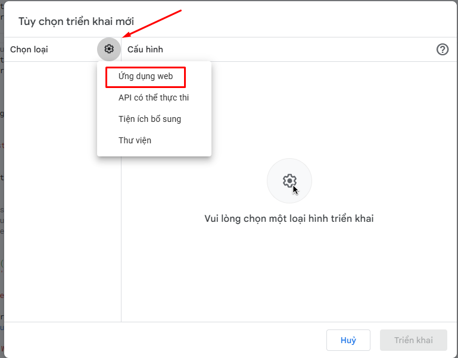
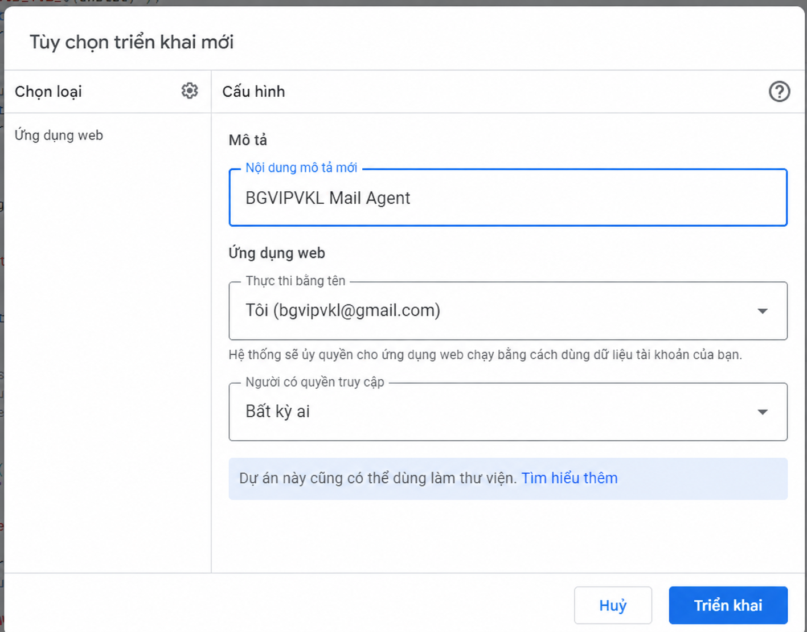
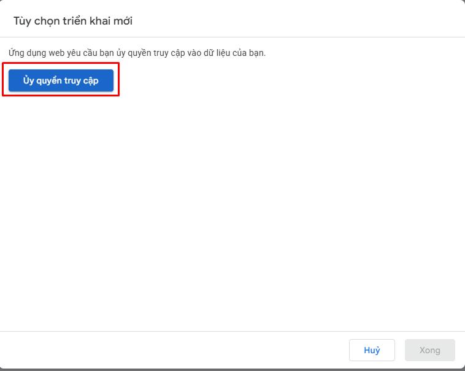
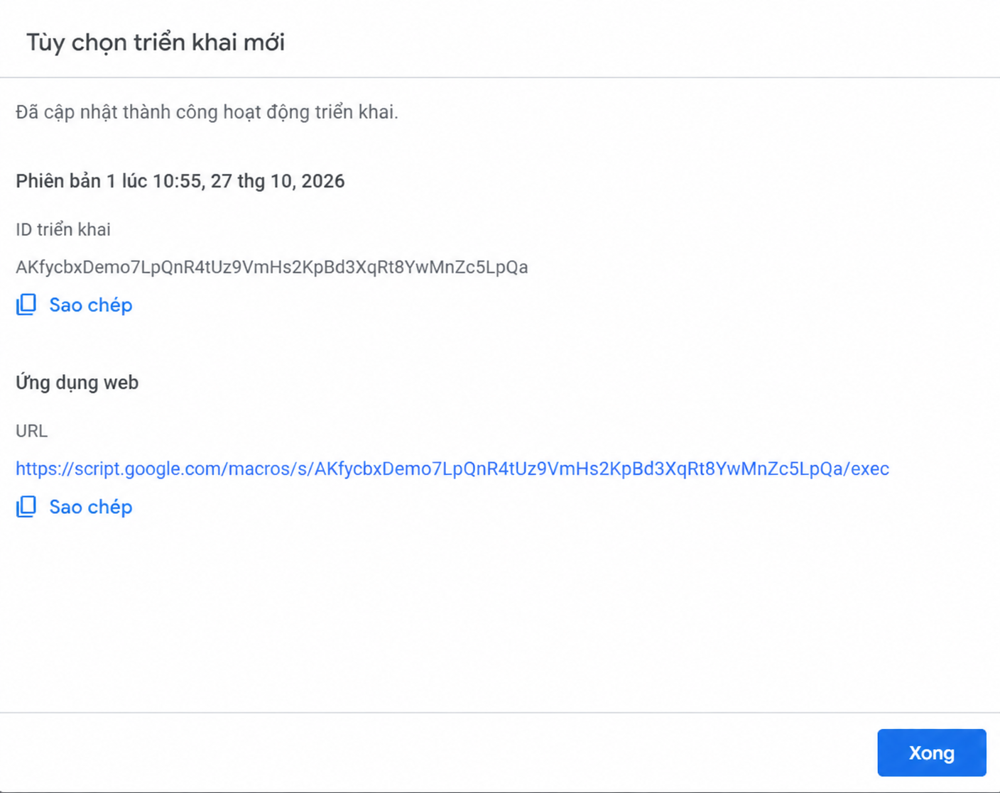
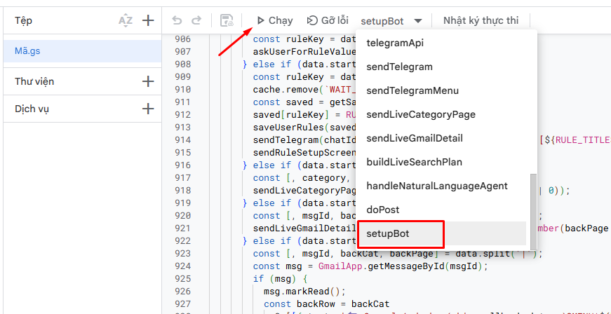
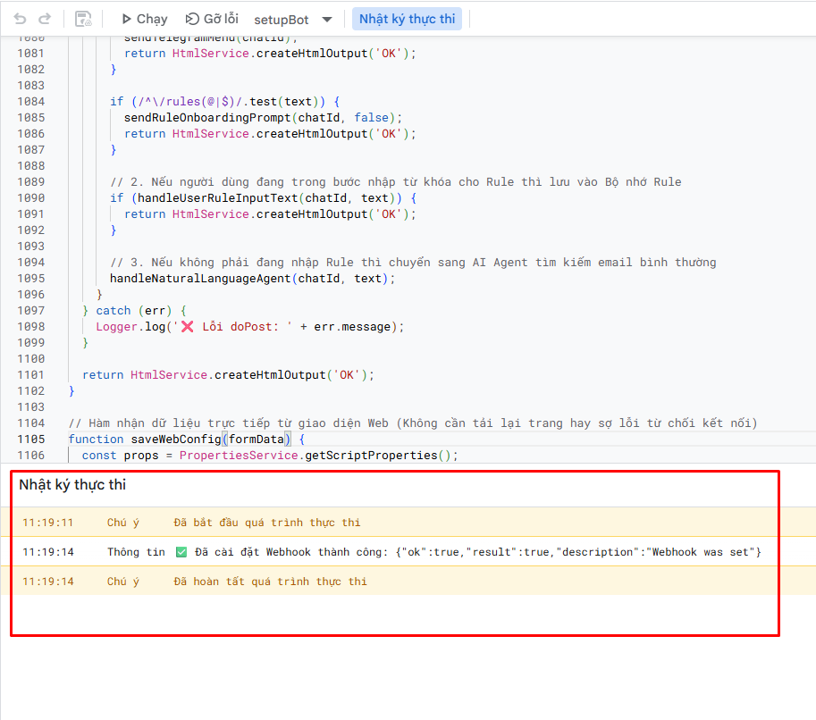
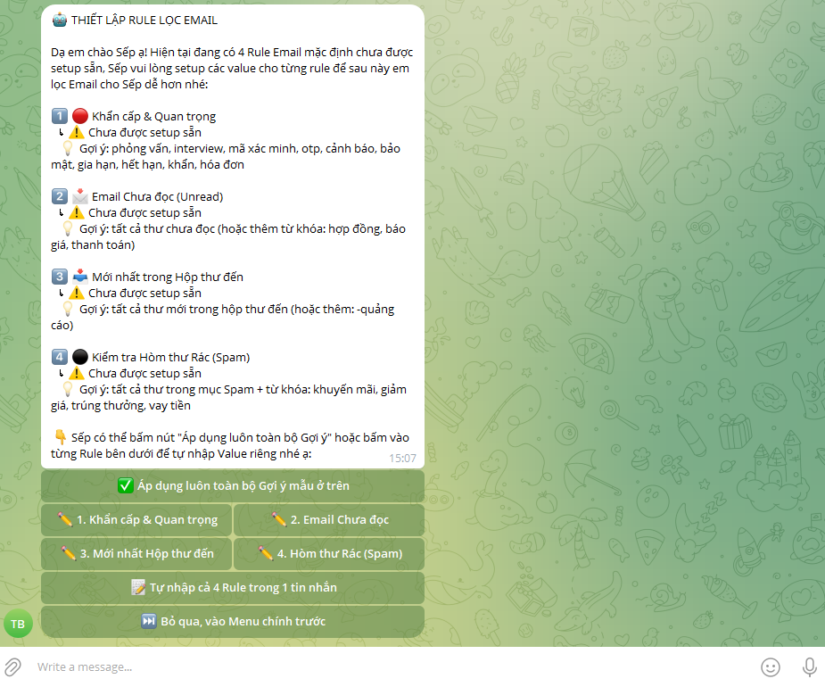

# 05 — Deploy Google Apps Script Web App

> **Cảnh báo trước khi triển khai công khai:** Phiên bản mã nguồn hiện tại đã bỏ trang Web cấu hình, nhưng `doPost(e)` vẫn dựa vào Chat ID trong dữ liệu request và **chưa xác minh nguồn gửi đáng tin cậy**. Chat ID có thể bị giả mạo. **Không triển khai publicly với Gmail có dữ liệu thật trước khi sửa và kiểm thử lớp xác thực webhook.** Các ảnh bên dưới chỉ hướng dẫn thao tác giao diện, không chứng nhận cấu hình an toàn.

## Tạo deployment

1. Tại trình chỉnh sửa Apps Script, nhấn **Triển khai → Tùy chọn triển khai mới**.

2. Nhấn biểu tượng chọn loại, chọn **Ứng dụng web**.

3. Nhập mô tả, ví dụ `AI Mail Agent`. Ảnh minh họa dùng **Thực thi bằng tên: Tôi** và **Người có quyền truy cập: Bất kỳ ai** để Telegram có thể gửi HTTP POST; cấu hình này rất nhạy cảm vì code sẽ chạy bằng quyền của chủ deployment.

4. Chọn **Triển khai**, sau đó thực hiện bước **Ủy quyền truy cập** bằng tài khoản của chính mình. Chỉ đồng ý nếu đã hiểu các quyền Gmail/Apps Script mà mã nguồn yêu cầu.

5. Khi triển khai thành công, sao chép **URL Ứng dụng web** kết thúc `/exec`. Mỗi tài khoản/từng deployment sẽ có URL riêng; **không sao chép URL minh họa trong ảnh**.

## Cấu hình sau triển khai

6. Quay về **Cài đặt dự án → Thuộc tính của tập lệnh**, điền `TELEGRAM_WEBHOOK_URL` bằng URL `/exec` **của chính bạn** rồi lưu. Xem [ảnh Script Properties](../images/04-script-properties.png).
## Kích hoạt Telegram Bot (môi trường thử nghiệm)

7. **Chỉ khi đã thiết lập cơ chế xác thực webhook phù hợp và dùng tài khoản thử nghiệm**, trong Apps Script Editor chọn hàm `setupBot` ở danh sách hàm, sau đó nhấn **Chạy**. **Không chạy thủ công `doPost(e)`**; Telegram sẽ tự gửi HTTP POST đến Web App khi có tin nhắn.

8. Mở **Nhật ký thực thi**, xác nhận phản hồi có `"ok":true` và `"description":"Webhook was set"`. Điều này chỉ xác nhận Telegram **đã đăng ký webhook**, không xác nhận các request gửi đến endpoint đã được xác thực. **Lưu ý:** trong ảnh minh họa này, vùng code nền thuộc phiên bản cũ còn hàm `saveWebConfig` — repo hiện tại đã bỏ hàm này.

9. Khi bot gửi thông báo thiết lập **4 Rule Email**, người dùng có thể chọn quy tắc mẫu hoặc tự nhập theo nhu cầu. Ảnh minh họa là màn hình onboarding của bot; việc hiển thị màn hình này không thay thế kiểm thử tính đúng đắn của xử lý email.

10. Chỉ kiểm tra lệnh `/start`, `/menu`, callback và Gmail bằng tài khoản/dữ liệu thử nghiệm. Nếu cập nhật mã nguồn, tạo version mới và chỉnh deployment để dùng version mới.

**Chú ý:** `setupBot()` hiện có thể xóa các pending updates khi đăng ký lại webhook; không chạy lặp lại tùy tiện.

Tài liệu chính thức: [Google Apps Script Web Apps](https://developers.google.com/apps-script/guides/web) · [Telegram Bot API — setWebhook](https://core.telegram.org/bots/api#setwebhook).
