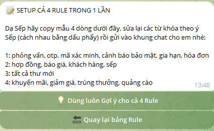
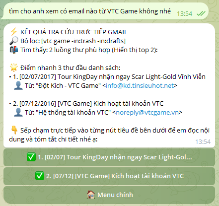

# 07 — Sử dụng AI Mail Agent lần đầu (Telegram)

> **Demo giao diện, chưa phải kiểm thử bảo mật.** Chỉ sử dụng tài khoản Gmail thử nghiệm khi webhook chưa có lớp xác thực request đủ tin cậy. Ảnh là ví dụ minh họa; thông tin email và mã trong ảnh không dùng để thao tác thật.

## 1. Mở bot và thiết lập 4 Rule

Sau khi đã cài `setupBot()`, mở bot Telegram và gửi `/start`. Khi cả 4 Rule chưa có giá trị, bot hiển thị hướng dẫn thiết lập.

Có thể **áp dụng tất cả gợi ý**, chỉnh từng Rule, hoặc nhấn **Tự nhập cả 4 Rule trong 1 tin nhắn**. Ở cách nhập thủ công, mỗi dòng có số thứ tự `1:` đến `4:` và các từ khóa cách nhau bằng dấu phẩy.

## 2. Kiểm tra đã lưu Rule và menu chính

Sau khi xác nhận, bot thông báo đã lưu Rule và hiển thị menu chính gồm Khẩn cấp & Quan trọng, Email Chưa đọc, Mới nhất trong Hộp thư đến, Hòm thư Rác và chỉnh sửa Rule.

## 3. Xem danh sách email

Chọn **Mới nhất trong Hộp thư đến** để xem danh sách email theo trang. Chạm vào tiêu đề để mở chi tiết, hoặc dùng **Trang sau** để chuyển trang.

## 4. Tra cứu bằng ngôn ngữ tự nhiên

Nhập câu hỏi tự nhiên, ví dụ `tìm cho anh xem có email nào từ VTC Game không nhé`. Agent sẽ tạo điều kiện tìm kiếm và hiển thị các kết quả phù hợp.

## 5. Xem chi tiết và đề xuất xử lý

Nhấn vào email để xem nội dung tóm tắt, đề xuất xử lý, hạn chót, mức độ và trạng thái đã đọc. Ảnh minh họa chi tiết email đã **thay nhất quán mã thông điệp bằng mã giả** `m8k4x2b7q9n5c1d` ở tiêu đề, cú pháp trả lời và đường dẫn Gmail. URL trong ảnh chỉ là ví dụ không đại diện email thật.

## Checklist thử nghiệm

- [ ] Bot phản hồi `/start` và `/menu`.
- [ ] Lưu được 4 Rule và quay lại menu.
- [ ] Xem danh sách email và chuyển trang.
- [ ] Mở được chi tiết một email thử nghiệm.
- [ ] Tìm kiếm bằng tiếng Việt trả về kết quả hợp lý.
- [ ] Thao tác thay đổi trạng thái hoặc tạo nháp chỉ thực hiện trên email thử nghiệm.

**Cảnh báo:** thành công trên Telegram không chứng minh webhook an toàn trước request giả mạo. Kiểm tra xác thực trước khi deploy production.
